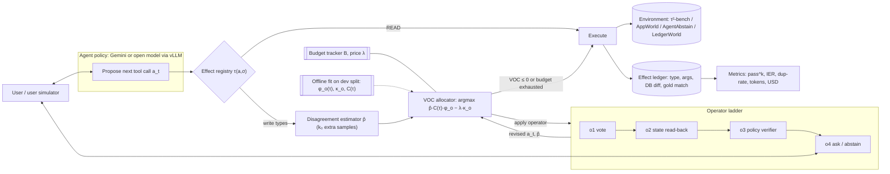

# 06 — Research Proposal and Draft Paper Plan

> **Decision record (2026-11-08).**
> - Flagship = Idea #1, chosen by you from the shortlist.
> - Resources: one paid Gemini API key, plus GPU access (size not yet specified — see
>   assumption A-1).
> - Venue strategy: workshop paper first, then a main-track paper.
>
> **Labels used throughout:** *Established* = cited finding. *Hypothesis* = ours. *Expected result* =
> a prediction, not data. **No experiment has been run. Every table in §15 is an empty template.**

---

## 0. Working title

**Think Where It Matters: Stakes-Weighted Test-Time Deliberation for Reliable Tool-Using Agents**

Alternatives:
- *Not All Steps Are Equal: Allocating Agent Compute by the Cost of Being Wrong*
- *Spend Thought Before You Commit*

## 1. Abstract (draft — bracketed values to be filled after experiments)

Tool-using LLM agents increasingly act on systems where mistakes are expensive or permanent:
cancelling bookings, issuing refunds, deleting records. Test-time compute (sampling, voting,
verification) is the main lever practitioners have to make agents more reliable. Yet recent work
finds that spending it uniformly across steps quickly saturates. Existing adaptive methods allocate
compute by the model's *uncertainty* alone, and have been evaluated only on tasks without lasting
side effects.

We argue this is mis-specified. The value of extra deliberation at a step is the product of:
- the probability the proposed action is wrong;
- the *cost* of that action being wrong, which depends on whether the action is read-only,
  reversible, compensable, or irreversible;
- the chance that deliberation fixes it.

We introduce **STAKES**, a model-agnostic harness controller. It types each tool call by effect
reversibility, estimates error probability from behavioural disagreement, and spends a bounded
token budget on an escalating ladder: resample, state read-back, verify, ask. The step with the
highest value of computation is served first.

On τ²-bench, AppWorld, AgentAbstain, and a controlled environment where we vary the share of
irreversible actions, we find [RESULT]. The comparison is against uniform, uncertainty-only, and
rule-based verify-before-write allocation at matched token budgets, using [N] models (Gemini and
open-weight). We report reliability (pass^k), irreversible-error rate, and cost. Our analysis
attributes the gains to [RESULT: e.g. high-stakes / low-uncertainty steps], and shows the method
is [RESULT] to mis-specified cost tables and mislabelled tools.

## 2. Introduction (paragraph plan)

1. **Hook.** Agents now execute irreversible actions. Reliability, not peak accuracy, decides
   whether they can be deployed (*established*: E5 introduces pass^k; Rabanser et al. 2026 find
   reliability lags accuracy).
2. **The lever.** Test-time compute improves LLM outputs, but in multi-step agents:
   - uniform per-step scaling saturates (CATTS, 2602.12276);
   - uniform voting adds about 0–2 pp because early errors lock in (2602.11619);
   - many "architectural" gains vanish at matched compute (M8, M9, M12).
3. **The gap.** Adaptive allocation exists, but it is driven by uncertainty (CATTS; AVA, TMLR 2026).
   Separately, a 2026 line of work characterises irreversibility as a dominant failure source:
   - post-hoc abstention (AgentAbstain);
   - duplicate side effects, with 90% false success on duplicated episodes (LIMBO);
   - semantic rollback attacks (ACRFence);
   - unsafe planning (LPS-Bench);
   - fleet-level risk budgets (Irreversibility Budget).

   These two lines have not been connected: no method uses an action's stakes to decide how much
   to think.
4. **Insight (hypothesis).** The classical *value of computation* from metareasoning prescribes
   weighting deliberation by the cost of error. In agents, that cost is highly skewed:
   - most steps are reads, where an error costs only a few tokens;
   - a few steps commit irreversible state.

   Uncertainty-only allocation wastes budget on uncertain-but-harmless reads. It also starves
   confident-but-wrong commits.
5. **Contributions.**
   - (i) A formulation of stakes-weighted test-time deliberation for side-effecting agents.
   - (ii) STAKES, a training-free harness controller with an operator ladder and a
     budget-respecting value-of-computation (VOC) allocator.
   - (iii) A compute-matched reliability evaluation protocol: cost–pass^k frontiers and
     irreversible-error rate.
   - (iv) LedgerWorld, a controlled environment with a tunable irreversible-action share, for
     dose–response tests.
   - (v) An empirical study across [N] models and 4 environments, with ablations and failure
     analysis.
   - (vi) Open-source code and logs.

## 3. Problem formulation

**Episode.** An agent with policy π (LLM + harness) interacts with environment E for up to T
steps.
- At step t it holds history h_t and proposes a tool call a_t ~ π(·|h_t).
- Executing a_t changes environment state σ_t → σ_{t+1}.
- Success is a predicate S(σ_T) checked by the environment (DB state or unit tests), *not* by an
  LLM judge.

**Effect type (agent-relative reversibility).** For action a in state σ, let A be the agent's tool
set. Following the taxonomy in Revisable by Design (2604.23283), and adding READ:
- **READ** — σ unchanged.
- **IDEMPOTENT** — repeating has no further effect.
- **REVERSIBLE** — ∃ a sequence of tools in A that restores σ exactly.
- **COMPENSABLE** — restoration is possible only up to a residual cost (e.g. a fee).
- **IRREVERSIBLE** — no sequence in A restores σ.

Write τ(a, σ) for this type. Reversibility is defined *relative to the agent's own tools*. That
makes it checkable per environment, and is the key definitional choice we defend in §12.

**Error and its cost.** A step is *erroneous* if a_t is not consistent with any successful
completion. In practice we use one of:
- (a) gold action sets (τ-bench-style annotations), or
- (b) counterfactual success under a fixed continuation policy (§8).

Let C(τ) be the expected loss of an erroneous action of type τ. We assume
C(READ) ≈ token cost ≪ C(REV) < C(COMP) < C(IRR). The cost table is a parameter. We report
results under several tables, plus one table estimated empirically as the failure rate following
an error of each type (§8).

**Deliberation operators.** O = {o₁ vote, o₂ read-back, o₃ verify, o₄ ask}. Each operator o has a
token cost κ_o and transforms (a_t, p̂_t) into a revised (a_t', p̂_t'). Its effectiveness is
φ_o(τ) = P(o corrects an erroneous action of type τ), fitted on a dev split.

**Objective.** Maximise expected reliability subject to a token budget:

  max_{policy over operators}  E[ S(σ_T) ] − Σ_t E[harm_t]   s.t.  Σ_t Σ_{o applied at t} κ_o ≤ B.

The Lagrangian relaxation with price λ gives a myopic VOC rule. At each step, apply the operator
with the highest positive

  VOC_t(o) = p̂_t · C(τ_t) · φ_o(τ_t) − λ · κ_o,

and repeat until no operator has positive VOC. Sweeping λ traces a cost–reliability frontier.

**Special cases (these define the baselines exactly):**

| Setting | Recovers |
|---|---|
| C ≡ const | Uncertainty-only allocation (CATTS-like) |
| p̂ ≡ const | Stakes-only allocation |
| Apply o₃ whenever τ ≥ REV | Rule-based verify-before-write |
| p̂ ≡ const and C ≡ const | Uniform deliberation |

**Proposition to prove or disprove (theory, main-track version).** Under step independence and
the myopic approximation:
- uncertainty-only allocation is VOC-optimal iff C(τ) is constant over the action types that
  actually occur;
- when C is skewed, the expected-loss gap between the VOC rule and uncertainty-only allocation
  grows with Var(C)·E[p̂].

*Status: conjecture. Not yet proven.*

## 4. Research questions and hypotheses

| RQ | Question | Hypothesis (falsifiable) | Falsified if |
|---|---|---|---|
| RQ1 | At matched compute, do uniform test-time strategies raise **pass^k**, or only pass@1? | H1: Uniform voting and reflection raise pass@1 more than pass^k. Verification-gated strategies raise pass^k most per token. | pass^k gains ≥ pass@1 gains for uniform voting, across models |
| RQ2 | Does stakes-weighted allocation dominate uniform and uncertainty-only allocation on the cost–reliability frontier? | H2: STAKES has a higher area under the pass^k-vs-tokens curve and lower irreversible-error rate (IER) than both, across ≥ 3 of 4 environments. | CIs overlap or reverse in ≥ 2 environments |
| RQ3 | Where do the gains come from? | H3a: Most of the improvement comes from high-stakes / low-disagreement steps. H3b: Most of the *savings* come from skipping deliberation on READ steps. | Gains concentrated in high-disagreement steps (then uncertainty-only suffices) |
| RQ4 | Does the benefit scale with how much irreversibility the task contains? | H4: The STAKES − uncertainty-only gap increases monotonically with the irreversible-action share ρ in LedgerWorld. | Flat or decreasing gap across ρ |
| RQ5 | How robust is STAKES to mis-specification? | H5: STAKES stays ≥ uncertainty-only with up to 20% mislabelled effect types, and under cost tables perturbed ×0.5–×2. | Falls below uncertainty-only within those ranges |
| RQ6 | Is the VOC allocator needed, or does verify-before-write capture everything? | H6: STAKES beats rule-based verify-before-write at matched cost, because it skips confident writes and escalates uncertain ones. | Verify-before-write matches STAKES within CIs (then the honest contribution is the evaluation + analysis; see §12, Q2) |

## 5. Related-work structure

1. **Test-time compute for LLMs and agents.**
   - Self-consistency, voting and more-agents (M6).
   - Debate critiques at matched compute (M8, M9, M12, M11).
   - Adaptive allocation: CATTS, AVA, learned-heuristic selective verification (2602.03975 [S]).
   - Positioning: we change the allocation *signal* (expected cost vs uncertainty) and the
     *setting* (side-effecting tasks).
2. **Reflection, verification and self-correction.**
   - P9–P14, P8, CRITIC (P11), LLM-Modulo (P7).
   - Positioning: our operators prefer state-grounded checks over self-critique (W3).
3. **Irreversibility, side effects and recovery.**
   - AgentAbstain, LIMBO, ACRFence, DART, DeltaBox (H22), GA-Rollback (E25), Revisable by Design,
     the Irreversibility Budget, LPS-Bench, ToolEmu (E14).
   - Positioning: they measure, restrict, or roll back; we decide where to think.
4. **Uncertainty and selective prediction for agents.**
   - SAUP (E22), behavioural consistency (2602.11619), KnowNo, and Rabanser et al.'s
     predictability metrics.
5. **Agent reliability evaluation.**
   - τ/τ²-bench (E5, E6), HAL (H6), AI Agents That Matter (E10), ABC (E12), Rabanser et al.
6. **Metareasoning and classical systems.**
   - Value of computation (Russell & Wefald, *Principles of Metareasoning*, Artificial
     Intelligence, 1991 — details from memory; verify).
   - Sagas and compensating transactions (Garcia-Molina & Salem, SIGMOD 1987 — details from
     memory; verify).

## 6. Methodology

### 6.1 Effect typing
- **Primary.** A per-environment registry mapping each tool to an effect type. τ²-bench and
  AppWorld have about 15–60 tools per domain, so this is about 1–2 hours of manual labelling per
  domain.
  - The labelling protocol uses the agent-relative definition (§3): for each write tool, search
    the tool list for an inverse.
  - Two annotators label each tool, or one annotator plus a rule-based check. We report agreement.
- **Secondary (for RQ5 and generality).** An LLM classifier gets the tool name, description and
  JSON schema, and outputs a type plus a justification. Its accuracy is measured against the
  registry.
- **Context-dependence.** Some tools vary by state (e.g. cancelling a refundable vs
  non-refundable booking). The registry allows a type function τ(a, σ) for such tools. We count
  how often this is needed.

### 6.2 Error-probability estimate p̂
- **Signal.** Sample k₀ ∈ {2, 3} extra candidate actions at the same history. Canonicalise each as
  tool name + normalised arguments: sorted keys, normalised strings and numbers. Then
  p̂ = 1 − (count of the modal action) / (k₀ + 1).
- **Variants:**
  - (i) semantic clustering of free-text arguments;
  - (ii) verbalised confidence;
  - (iii) logprob-based (open models only).
- **Cost.** Sampling is charged to the budget. **Stakes-aware saving:** p̂ is never computed for
  READ actions, because their VOC is ≈ 0.

### 6.3 Operator ladder
| Op | What it does | Grounding | Typical κ |
|---|---|---|---|
| o₁ vote | Draw n more candidates and take the modal canonical action | model | n × step tokens |
| o₂ read-back | LLM lists the preconditions the action assumes (e.g. "booking X exists, is refundable"), calls READ tools to check them, then re-proposes | **environment state** | 1–3 read calls + 1 step |
| o₃ verify | A separate verifier prompt checks the action against the domain policy, instructions and gathered facts; returns approve/revise | model + policy text | 1 step |
| o₄ ask | Pose a clarification or confirmation question to the user (τ² user simulator), or abstain (AgentAbstain) | user | 1 turn + user cost |

Fitting:
- φ_o(τ) and κ_o are estimated on a **dev split** of tasks that is disjoint from test.
- They come from offline replays at sampled steps with known gold actions.
- Reported with CIs.

### 6.4 Allocator
- **Myopic VOC with a budget price λ** (Algorithm 1).
- Two budget modes:
  - (a) **λ-sweep** — the main experiments; traces the frontier;
  - (b) **paced** — λ is adapted online so that per-episode spend ≈ B (Algorithm 2), for
    deployment realism.
- **No training.** All parameters (C, φ, κ) are tables, which keeps the method interpretable and
  cheap.

### 6.5 Effect ledger (evaluation instrument)
- A wrapper records every tool call: type, arguments, pre/post DB diff, and whether it matches
  the gold effect.
- The ledger computes IER, duplicate rate, and harm.
- Because it reads environment state, the headline metrics need no LLM judge.

## 7. System architecture



## 8. Algorithms

```text
Algorithm 1  STAKES-Step(h_t, π, T, C, φ, κ, λ, b)
  a ← π(h_t)                                   # proposal
  τ ← T(a, σ_t)
  if τ = READ: return Execute(a), b
  cands ← {a} ∪ {π(h_t) sampled k₀ times};  b ← b − k₀·cost_step
  p̂ ← 1 − maxcount(Canon(cands)) / |cands|
  U ← O                                        # operators not yet used at this step
  loop
     o* ← argmax_{o∈U} [ p̂·C(τ)·φ_o(τ) − λ·κ_o ]
     if VOC(o*) ≤ 0 or κ_{o*} > b: break
     (a, p̂) ← Apply(o*, h_t, a, cands)        # vote | read-back | verify | ask
     b ← b − κ_{o*};  U ← U \ {o*}
     τ ← T(a, σ_t)                             # the revised action may have a different type
  return Execute(a), b                         # the ledger logs (a, τ, Δσ)

Algorithm 2  Budget pacing (optional deployment mode)
  λ₀ given; after each step t:
     target_t ← B · t / T_expected
     λ ← λ · exp(η · (spent_t / target_t − 1))   # spend too fast → raise price

Algorithm 3  Offline fitting (dev split only)
  for sampled steps (h, a_gold) from baseline rollouts on dev tasks:
     τ ← T(a_gold);  record whether π's proposal ≠ a_gold   → error base rates per τ
     for o in O: apply o to the erroneous proposals → φ_o(τ) = fix rate;  κ_o = mean tokens
  empirical C(τ): P(task fails | an uncorrected error of type τ occurred) from dev rollouts
```

## 9. Component-level design

| Component | Interface | Notes |
|---|---|---|
| `EffectRegistry` | `type(tool, args, state) -> EffectType` | YAML per environment, with optional Python hooks for state-dependent tools |
| `Canonicalizer` | `canon(tool_call) -> key` | Deterministic; unit-tested on ambiguous argument formats |
| `DisagreementEstimator` | `estimate(h, a, k0) -> p̂, cands` | Parallel sampling; temperature as a configurable parameter |
| `Operator` (ABC) | `apply(h, a, cands) -> (a', p̂', tokens)` | o₁–o₄; each operator logs its own token use |
| `Allocator` | `step(...)` | VOC; modes = sweep / paced / uniform / uncertainty-only / stakes-only / rule-based |
| `Ledger` | wraps the env tool executor | DB diff before/after each write; gold matching |
| `BudgetTracker` | counts input / output / cached tokens per call | Uses provider usage fields, not estimates |
| `EnvAdapter` | `reset(task) / tools() / execute() / user_turn() / grade()` | τ², AppWorld, AgentAbstain, LedgerWorld |
| `Runner` | `(env, model, strategy, λ, seed) -> trajectory.jsonl` | Idempotent and resumable; content-hash cache |

## 10. Inference procedure (no training)

1. For each (environment, model): run baseline rollouts on the **dev split** (≈ 20% of tasks;
   fixed seeds) → Algorithm 3 → freeze C, φ, κ.
2. On the **test split**: for each strategy × λ-grid (≈ 6 points) × k = 8 trials, run episodes.
   - Fixed user simulator: Gemini Flash-tier, at a fixed temperature, *identical across conditions*.
   - Log everything.
3. Compute frontiers. Compare strategies at matched mean tokens by interpolating along each curve.
   Bootstrap over tasks (10k resamples); use paired permutation tests on the per-task difference
   at matched budget.

**Model plan for your resources:**
- **API.** Gemini Flash-tier as the main agent, and as the user simulator. Gemini Pro-tier on a
  subset (one domain) to test scale.
  - Use whichever versions are current at experiment time. Record the exact model IDs and dates.
- **Open-weight (GPU).** Two instruct models with native tool calling, served with vLLM:
  - a ~7–8B model;
  - a ~30B-class model, if the GPU allows (≥ 48–80 GB, or a quantised variant).
  - The open models make the work reproducible and allow logprob-based p̂.
- **Assumption A-1:** GPU size is unknown. If it is ≤ 24 GB, use the 7–8B model only, plus a
  quantised ~14B model.

## 11. Dataset and data-generation strategy

| Environment | Why | Grading | Status |
|---|---|---|---|
| **τ²-bench** (airline, retail, telecom) | Realistic policy-constrained writes; user simulator supports o₄; dual control in telecom | DB-state + gold actions | Public (E6) |
| **AppWorld** | Many apps and APIs; state-based unit tests; long horizons | Programmatic tests | Public (cited by H19/H20) |
| **AgentAbstain** | Paired act/abstain tasks; irreversibility is central; deterministic commit check | Commit check + judge (we use only the commit check) | Code/data availability **to verify** |
| **LedgerWorld** (ours) | Controlled dose–response over the irreversible share ρ | Exact final-state match | To build (§11.1) |

### 11.1 LedgerWorld (controlled environment we build)
- **Services:** a bank, an inventory, a mailer, a scheduler. Each service gets an
  explicitly typed tool set (READ / IDEMPOTENT / REV / COMP / IRR).
- **Tasks:** generated from templates, with a ground-truth final state, distractor information,
  and ambiguity injected before writes. Ambiguities include similar names, stale records, and
  conflicting instructions.
- **Knob ρ:** controls the fraction of required writes that are irreversible, ρ ∈
  {0, 0.1, 0.25, 0.5}. A second knob controls trap density (steps designed to elicit confident
  errors).
- **No LLM in the loop for grading or the user.** A scripted user answers clarifications from the
  ground truth, which avoids W3.
- **Size:** about 300 tasks per ρ level. Generator code is released, and a held-out seed set is
  generated *after* method freeze, to avoid tuning on test.

### 11.2 Splits and leakage control
- Dev/test split by task ID, fixed before any method tuning.
- C, φ, κ and the λ-grid are fit only on dev.
- No prompt engineering on test.
- The LedgerWorld test seeds are generated after code freeze.

## 12. Baselines (all at matched token budget)
1. **Single run** (temperature 0) and **single run at temperature T**, used for pass^k.
2. **Uniform vote-n** at every step.
3. **Uniform verify** at every step.
4. **Rule-based verify-before-write** (o₃ on every τ ≥ REV). This is the *strong simple
   baseline*.
5. **Uncertainty-only** (CATTS-style: the same estimator and ladder, with C ≡ const).
6. **AVA-style** allocation, if reimplementable from its code release
   (github.com/llmsresearch/AVA, linked from its page).
7. **Reflexion-style retry** and **best-of-N trajectories**. Both need environment resets, so they
   are reported as a *reset-oracle reference*: they are unavailable in real irreversible
   deployments, which is part of our argument.
8. **Oracle stakes** (true error labels at write steps): an upper bound.

## 13. Experimental protocol
- **Workshop version (≈ 11 weeks):**
  - RQ1 + RQ2 + a light RQ3, on τ²-bench (airline + retail) and LedgerWorld v0 (one ρ sweep).
  - Models: Gemini Flash-tier + one open 7–8B model.
  - k = 4.
- **Main-track version:**
  - all RQs, all 4 environments, 3–4 models, k = 8;
  - full ablations; Pro-tier subset; theory proposition.
- **Stopping rule:** a pre-registered primary metric (pass^4 at the matched budget point B* =
  median single-run cost × 3), fixed before test runs.
- **Seeds and temperature:** recorded per call. Provider-side nondeterminism is acknowledged, and
  measured via repeated temperature-0 runs.

## 14. Metrics (formal)
- **pass^k** = E_task[ C(c, k) / C(n, k) ], with c successes out of n ≥ k trials (unbiased, as in
  τ-bench). Also **pass@k** = E_task[ 1 − C(n−c, k) / C(n, k) ].
- **IER** (irreversible-error rate) = erroneous IRR/COMP commits per episode, from the ledger.
- **Duplicate-effect rate** = repeated non-idempotent effects per episode.
- **Harm-weighted utility** = success − Σ C(τ) · 1[erroneous commit] − λ_report · tokens.
- **Cost** = input, output and cached tokens, and USD at a parametrised price sheet.
- **Frontier AUC** = area under pass^k vs log-tokens over the common cost range. Also the
  **budget-to-target**: tokens needed to reach a pass^k target.
- **Rabanser reliability profile** (subset): C_out, R_prompt, P_AUROC.
- **Operator stats:** invocation rates by τ, fix rates, ask rate (interruption burden).

## 15. Expected results and result-table templates

> These are **expected results** (hypotheses), *not* data. Fill the tables after running.

**Expected (H2):**
- STAKES ≥ uncertainty-only ≥ uniform on frontier AUC in τ²-airline/retail and LedgerWorld ρ ≥ 0.25.
- The smallest gap is on τ²-telecom, where dual control already suppresses some errors
  (*established* context: 2606.09863 [S]).

**Expected (H6):**
- Verify-before-write is close to STAKES at high budgets.
- STAKES wins at low/medium budgets, because it skips confident writes.
- If this is false, the paper reframes around the evaluation protocol and the analysis (§18, Q2).

**Table 1 — Main results at matched budget B* (pass^4, IER, tokens). Mean ± 95% bootstrap CI.**

| Env | Model | Single | Uniform vote | Verify-before-write | Uncertainty-only | **STAKES** | Oracle stakes |
|---|---|---|---|---|---|---|---|
| τ²-airline | Gemini Flash | | | | | | |
| τ²-airline | Open-8B | | | | | | |
| τ²-retail | Gemini Flash | | | | | | |
| τ²-retail | Open-8B | | | | | | |
| AppWorld | … | | | | | | |
| AgentAbstain | … | | | | | | |
| LedgerWorld ρ=0.25 | … | | | | | | |

**Table 2 — RQ1: pass@1, pass@4, pass^4 under uniform strategies at 1×, 3×, 5× budget.**

| Strategy | Budget | pass@1 | pass@4 | pass^4 | Failure ICC |
|---|---|---|---|---|---|
| | | | | | |

**Table 3 — RQ3: gain decomposition by step class (share of total pass^4 gain vs uncertainty-only).**

| Step class | % of steps | % of tokens (STAKES) | % of tokens (unc-only) | % of gain |
|---|---|---|---|---|
| READ | | | | |
| Write, low p̂ | | | | |
| Write, high p̂ | | | | |
| IRR, low p̂ | | | | |
| IRR, high p̂ | | | | |

**Table 4 — RQ4: LedgerWorld dose–response (frontier-AUC gap, STAKES − uncertainty-only).**

| ρ | 0 | 0.1 | 0.25 | 0.5 |
|---|---|---|---|---|
| Gap (± CI) | | | | |

**Table 5 — RQ5: robustness (frontier AUC relative to clean STAKES).**

| Perturbation | 0% | 10% | 20% | 40% mislabel | C ×0.5 | C ×2 | LLM-typed |
|---|---|---|---|---|---|---|---|
| | | | | | | | |

**Table 6 — Ablations.**

| Variant | Frontier AUC | IER | Tokens @ target |
|---|---|---|---|
| Full STAKES | | | |
| − stakes term (= unc-only) | | | |
| − uncertainty term (= stakes-only) | | | |
| − read-back o₂ | | | |
| − verifier o₃ | | | |
| − ask o₄ | | | |
| Coarse typing (READ vs WRITE only) | | | |
| p̂ via verbalised confidence | | | |
| p̂ via logprobs (open models) | | | |
| Constant φ (no fitting) | | | |

**Figures planned:**
- F1: cost–pass^k frontiers per environment.
- F2: token-allocation heatmap by step class.
- F3: dose–response over ρ.
- F4: case studies of a confident-but-wrong irreversible commit caught by o₂.

### How results map to hypotheses
| Outcome | Interpretation |
|---|---|
| H2 ✓, H3a ✓ | Core claim supported: stakes matter beyond uncertainty |
| H2 ✓, H3a ✗ (gains from high-p̂ steps) | Gains come from better ladder operators, not from stakes. Reframe around the operators. |
| H2 ✗, H6 ✗ (verify-before-write ≈ STAKES) | The simple rule is enough. Publish as an evaluation and analysis paper: "a simple rule matches adaptive allocation". |
| H4 flat | Stakes signal is irrelevant at realistic ρ. Report as a negative result with the dose–response evidence. |
| H5 ✗ | Fragility finding; motivates learned effect typing (future work). |

## 16. Error analysis plan
- **Failure taxonomy** by ledger evidence:
  - (a) error at a READ that propagated;
  - (b) confident wrong commit (low p̂, high C);
  - (c) uncertain commit that was escalated but the operators failed;
  - (d) budget exhausted;
  - (e) over-asking (user annoyance proxy);
  - (f) effect mis-typing;
  - (g) user-simulator error (a W3 artefact).
- Hand-annotate 100 failed episodes per main condition. Two annotators on a 30-episode overlap;
  report Cohen's κ.
- **Disagreement–error calibration curves** per effect type: is p̂ informative for writes?
- **Operator failure cases:** read-back that checks the wrong preconditions; a verifier that
  rubber-stamps.

## 17. Limitations (anticipated)
- Effect typing is manual for the main results. LLM typing is evaluated, but may fail on novel or
  ambiguous tools.
- The cost tables are a modelling choice; mitigated by the empirical C and the sensitivity
  analysis.
- Benchmarks are simulated. "Irreversible" means irreversible *within the agent's tool set*, not
  real-world harm.
- User simulators are LLMs (τ²). LedgerWorld uses a scripted user as a control.
- Myopic VOC ignores long-range effects of reads. That is a modelling simplification; see the
  failure class (a).
- A single API provider (Gemini) plus open models. Results may differ for other providers.

## 18. Ethics and safety
- **Positive aim.** Fewer harmful irreversible actions by deployed agents.
- **Dual use** is minimal. The method makes agents more cautious at high-stakes steps.
- Risk of **over-trust**: "STAKES-protected" agents still err. The paper will report residual IER
  prominently.
- **No human subjects** beyond the authors' annotation. No personal data. LedgerWorld is
  synthetic.
- **Asking-burden fairness.** Report interruption rates, since over-asking shifts cost to users.
- Follow the API provider's terms. Release logs only where the licences allow.

## 19. Reproducibility plan
- Code (MIT or Apache-2.0), configs, and the effect registries per environment.
- LedgerWorld generator plus frozen test seeds.
- All trajectories as JSONL, with token-usage records. Exact model IDs and API dates.
- One command per table: `make table1` etc.
- The open-weight model results are fully re-runnable.
- The Gemini results come with logs, because API models change.
- Report provider nondeterminism (repeated temperature-0 variance).
- Follow ABC (E12) and the AI Agents That Matter (E10) recommendations: cost reporting, holdouts,
  and the checklist attached as an appendix.

## 20. Timeline and milestones (detail in `09-week-by-week-plan.md`)
| Milestone | Target week (start Mon 2026-11-16) |
|---|---|
| M0 Go/no-go pilot (§13 of `13-what-to-build-first.md`) | W3 (≈ Dec 4) |
| M1 Harness + ledger + metrics, tests passing | W4 |
| M2 RQ1 + RQ2 on τ² (2 domains) | W9 |
| M3 Workshop paper submitted | W12 (≈ early Feb 2027) |
| M4 LedgerWorld + AppWorld + AgentAbstain adapters | W17 |
| M5 Full runs + ablations | W23 |
| M6 Main-track submission | W26 (≈ mid-May 2027) |

## 21. Venue targets (deadlines approximate — verify on the venue sites)
- **Workshop (non-archival preferred, so the main paper is not blocked):** ICLR 2027 workshops on
  agents, reliability or test-time compute, typically due ~early Feb. ICML 2027 workshops,
  ~May–June, are a fallback. Check each workshop's dual-submission policy.
- **Main track:**
  - **NeurIPS 2027** (~mid-May) is the primary target.
  - **COLM 2027** (~March) is an alternative if the workshop goes well early.
  - **ICLR 2028** (~late Sept/Oct 2027) is the fallback.
- **Possible partial-results venues:** an agent-safety track, or AAMAS for the decision-theoretic
  framing.
